## 🛡️ AtmaRaksha — Women's Safety Android App

**Your Safety. Your Strength. Your Raksha.**

An Android application designed to support women's safety through emergency assistance, trusted contacts, safer journeys, and discreet safety tools.

**Tech Stack:** Java • XML • Android Studio

---

## 🌸 About AtmaRaksha

AtmaRaksha brings essential safety features together in one Android application. It aims to help users access emergency tools, manage trusted contacts, explore nearby assistance, and use safety resources during everyday journeys.

## ✨ Key Features

- 🆘 **Emergency SOS** — Access emergency assistance features.
- 👥 **Trusted Contacts** — Manage emergency contacts.
- 📍 **Nearby Help** — Explore nearby assistance and useful places.
- 🗺️ **Safer Routes** — View route information for journey planning.
- 🚶 **Journey Monitoring** — Access journey-related safety tools.
- 📳 **Shake-to-SOS** — Use a shake-triggered safety shortcut.
- 📢 **Emergency Siren** — Attract attention with a siren.
- 📞 **Fake Incoming Call** — Simulate an incoming call to help leave an uncomfortable situation.
- 🎙️ **Voice SOS** — Access voice-based SOS features.
- 🎥 **Evidence Recording** — Access safety-related recording tools.
- 🕵️ **Discreet Mode** — Use discreet safety features.
- 📴 **Offline Safety** — Access supported offline safety information.
- 📚 **Safety Resources** — Read safety instructions and tips.
- 📊 **Safety History** — Review supported safety activity.
- 📰 **Safety News and Community Reports** — Explore safety-related information.

*Feature availability depends on device permissions, connectivity, Android version, and testing. The app does not guarantee emergency response or personal safety.*

## 🛠️ Technology Stack

| Component | Technology |
|---|---|
| Programming language | Java |
| User interface | XML |
| Development environment | Android Studio |
| Build system | Gradle |
| Android components | Activities, Intents, Services, Broadcast Receivers |
| Location and routing | Location services, OpenStreetMap-related services, OSRM |
| Nearby places | Overpass API |
| User interface components | RecyclerView and Android layouts |
| Device capabilities | Sensors, media playback, recording APIs |
| Local data | Android local storage and database components |

## 📲 Installation and APK

AtmaRaksha is distributed as an **APK for testing and demonstration**. It is not being presented as a Google Play Store release.

1. Download the APK provided by the project team.
2. Transfer it to your Android phone if needed.
3. Open the APK file.
4. Allow installation from that source if Android prompts you.
5. Install and launch the app.
6. Grant the permissions needed for the features you want to test.

**Note:** Install APKs only from sources you trust. Certain features may depend on device settings and internet availability.

## 🎬 Demo and Downloads

- **GitHub Repository:** [AtmaRaksha-Womens-Safety](https://github.com/juveriya16/AtmaRaksha-Womens-Safety)
- **Demo Video:** Add your demo video link here.
- **Project Presentation:** Add your presentation link here.
- **APK Download:** Add your APK link here if hosted.

Make sure shared files are accessible to anyone with the link before submitting.

## 🖼️ Screenshots

### Welcome Screen
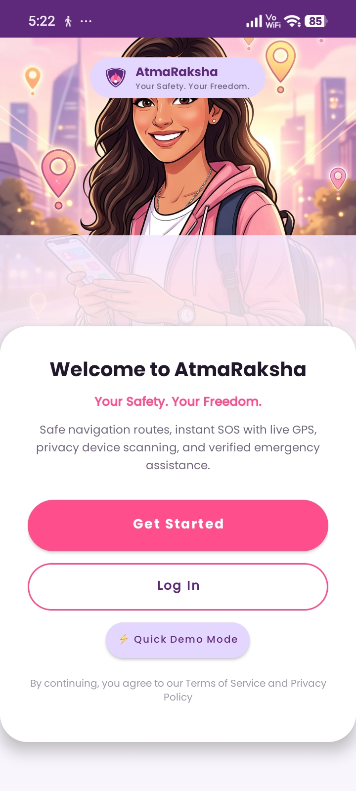

### Login Screen
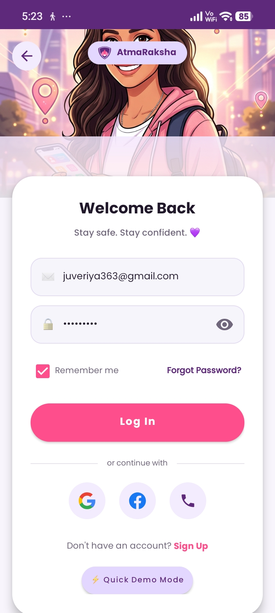

### Home Dashboard
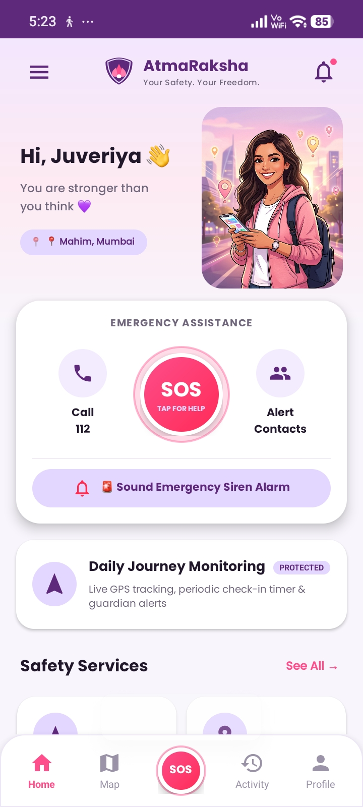

### Safety Services
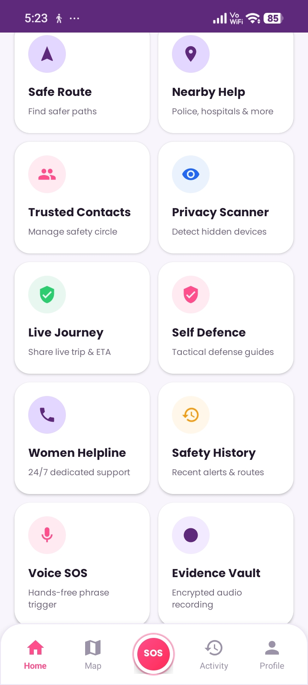

### Safety History
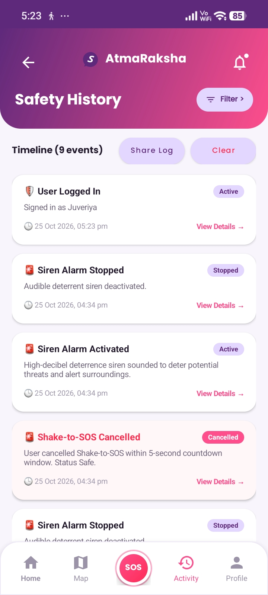

### Safe Routes Map
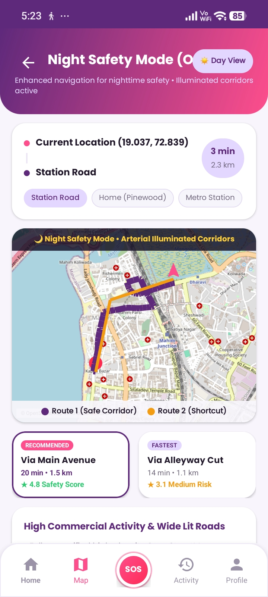

### Profile and Settings
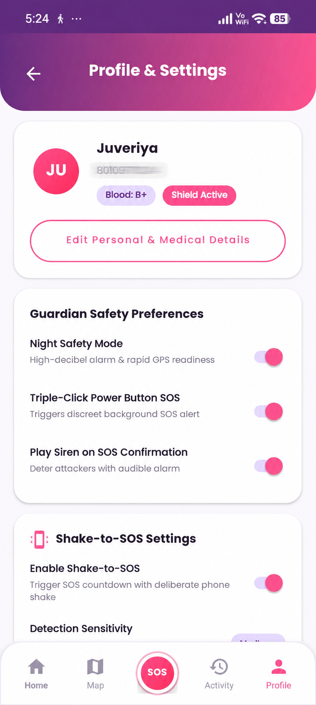

### Fake Incoming Call
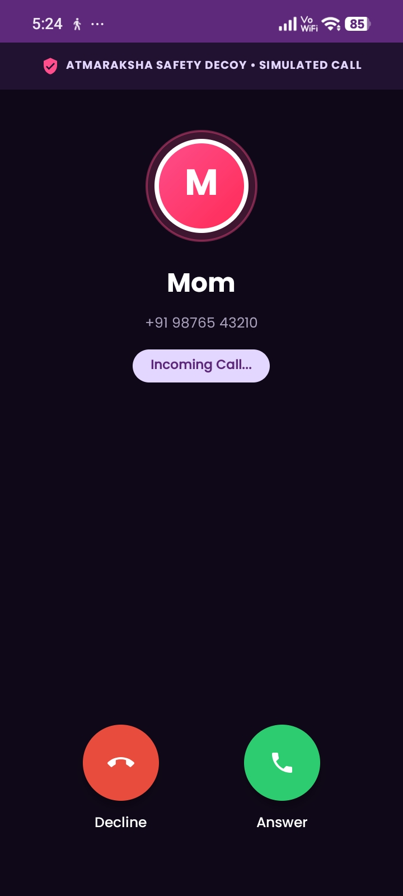

### Trusted Emergency Contacts
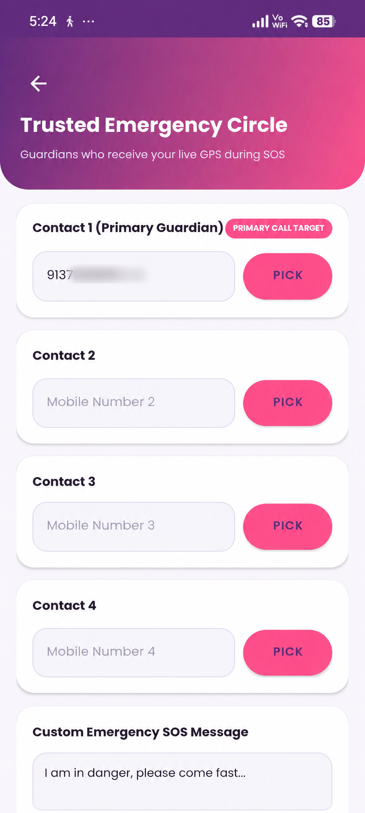

### Community Safety Reports
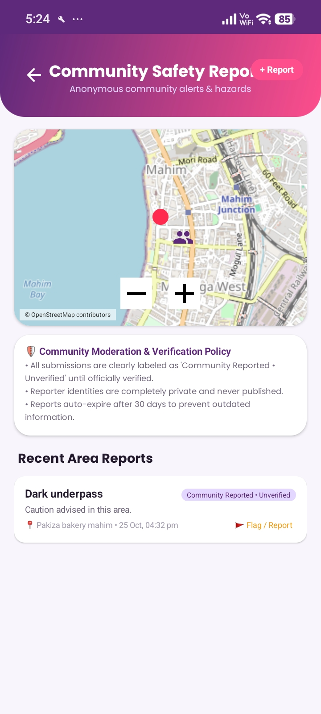

### Emergency SOS Alert
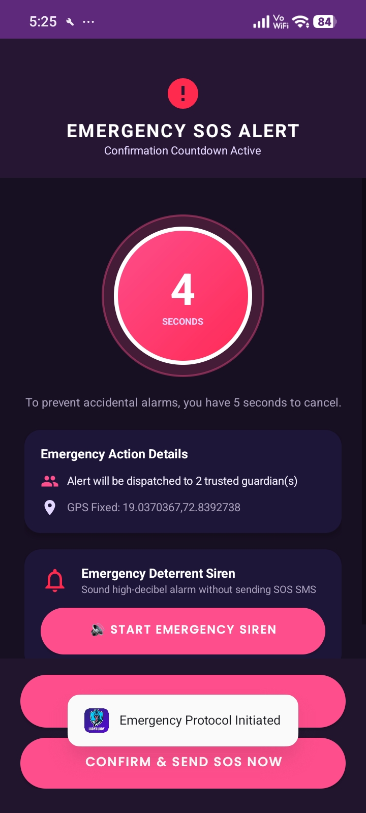

## 🏗️ Project Structure

```text
AtmaRaksha-Womens-Safety/
├── app/
│   ├── src/
│   │   ├── main/
│   │   │   ├── java/com/sum/ladybuddy/
│   │   │   ├── res/
│   │   │   ├── assets/
│   │   │   └── AndroidManifest.xml
│   │   └── test/
│   └── build.gradle
├── gradle/
├── build.gradle
├── gradle.properties
├── gradlew
├── gradlew.bat
├── settings.gradle
└── README.md
```

## 💻 Run Locally

**Prerequisites**
- Android Studio
- Compatible JDK
- Android SDK
- Android device or emulator

**Steps**

1. Clone the repository:

   ```bash
   git clone https://github.com/juveriya16/AtmaRaksha-Womens-Safety.git
   ```

2. Open the project in Android Studio.
3. Allow Gradle to sync.
4. Connect an Android device or start an emulator.
5. Build and run the app.

To build a debug APK on Windows, run this command from the project root:

```powershell
.\gradlew.bat assembleDebug
```

The APK is typically generated at:

`app/build/outputs/apk/debug/app-debug.apk`

## 🔐 Responsible Use

- Grant permissions only when needed.
- Verify emergency contact details before relying on emergency features.
- Test emergency communication features in a controlled environment.
- Some functionality may be restricted by Android settings, carriers, or network availability.
- Do not rely on this app as a replacement for official emergency services.

## 🎯 Project Objective

AtmaRaksha aims to make practical safety tools more accessible through Android technology, supporting greater awareness, preparedness, and confidence during everyday journeys.

---

**AtmaRaksha 🛡️ — Your Safety. Your Strength. Your Raksha.**
